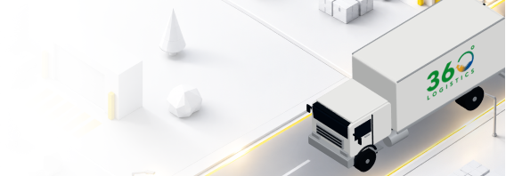
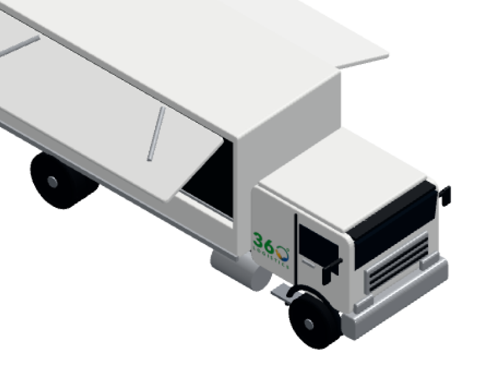
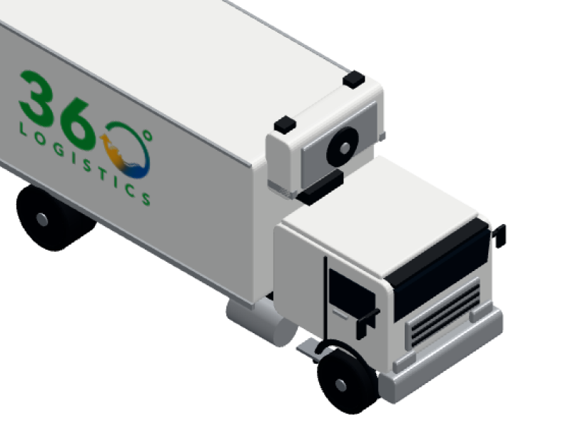
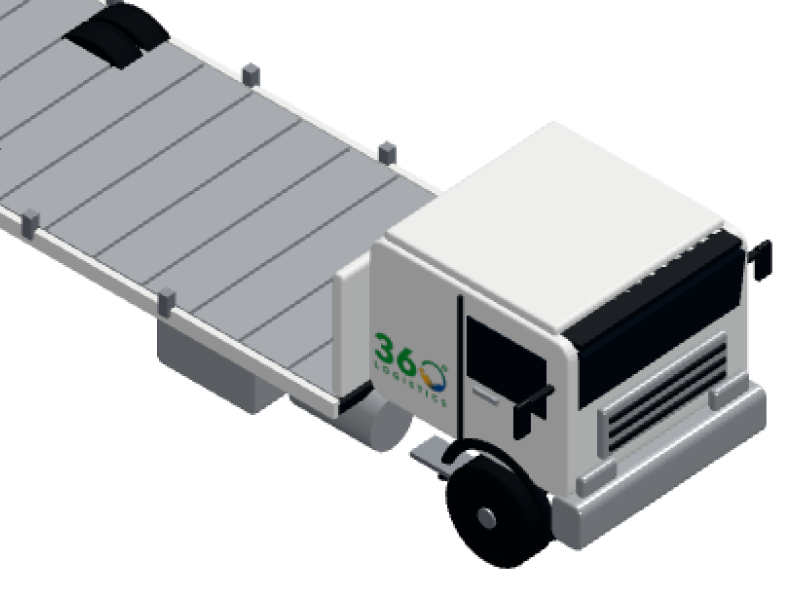
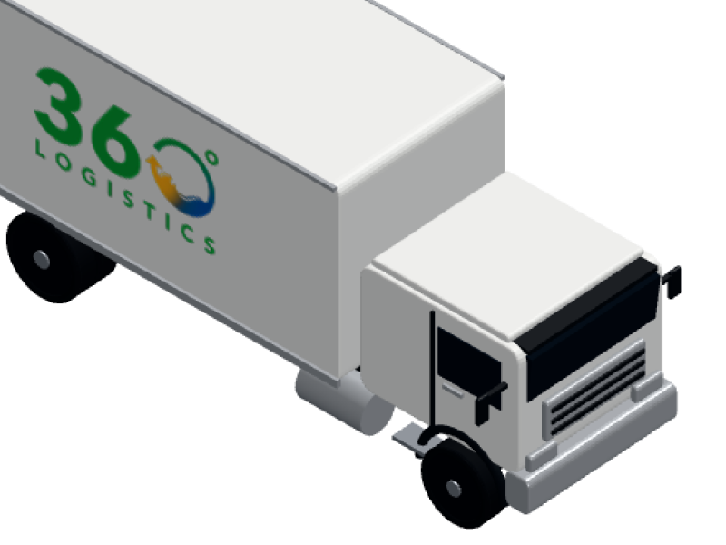
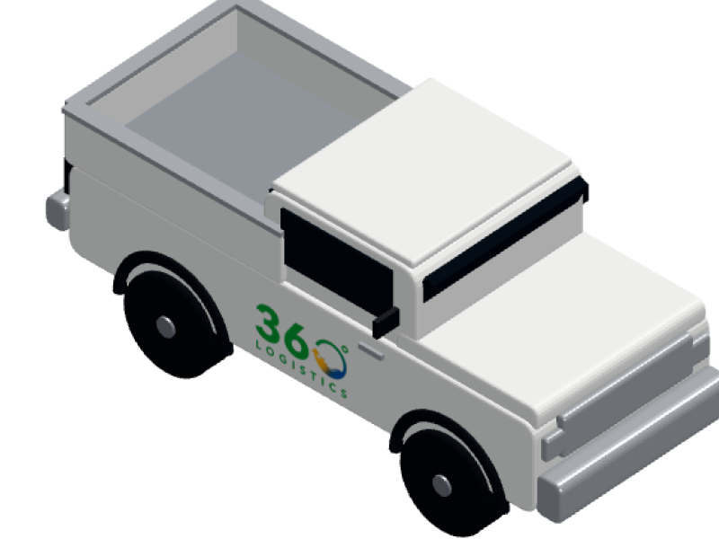
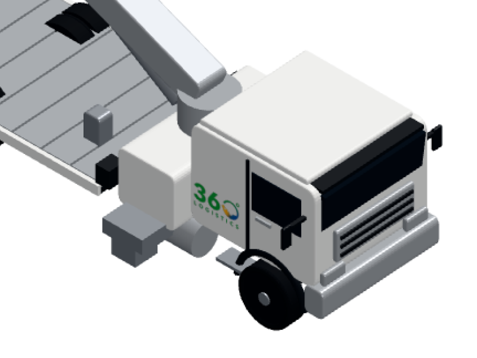
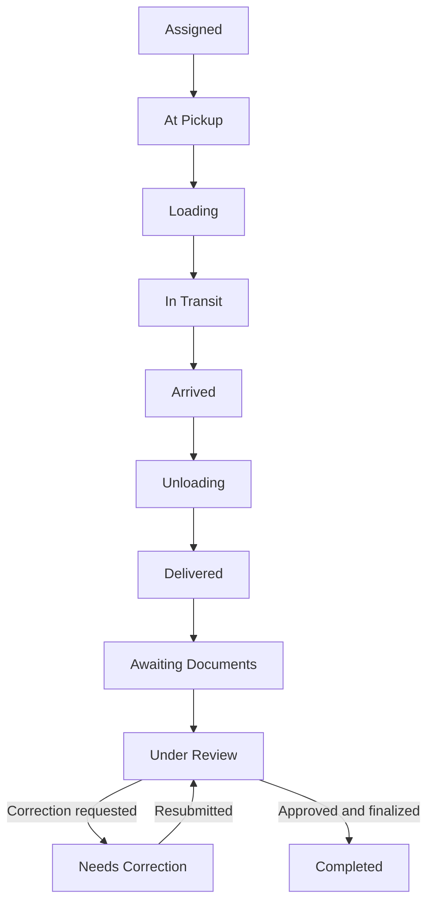

<div align="center">


<h1>360 LOGISTICS PH</h1>

<p><strong>From Dispatch to Delivery. One Connected Workflow.</strong></p>

<p>A logistics operations platform connecting dispatch, delivery monitoring, fleet coordination, photo evidence, and document review.</p>

<p>
  
  
  
  
  
  
</p>

<p>
  <a href="#overview">Overview</a> · <a href="#features">Features</a> · <a href="#system-preview">System Preview</a> · <a href="#delivery-workflow">Workflow</a> · <a href="#tech-stack">Tech Stack</a> · <a href="#getting-started">Getting Started</a>
</p>

</div>

<br />


## Overview

360 Logistics PH brings staff and drivers into one delivery workflow. Customer Service Representatives coordinate assignments and review delivery evidence. Operations Managers oversee fleet and staff resources. Drivers use a mobile interface to progress through delivery stages, capture required photos, report issues, and submit documents.

The interface is built around clear status indicators, compact operational views, and distinct physical-delivery and document-review milestones.

## System Preview

The repository includes the following **application artwork**, shown here as illustrations rather than screenshots of live records. Public-safe screenshots of the six modules are not currently included in the repository; operational data and personal details are intentionally excluded from this README.

<table>
  <tr>
    <td align="center" width="50%"><br /><strong>Connected operations</strong><br />Login screen artwork</td>
    <td align="center" width="50%"><br /><strong>Dispatch to delivery</strong><br />Alternate branded artwork</td>
  </tr>
</table>

### Explore the interface

| Dashboard | Dispatch & Drivers | Deliveries |
| :--- | :--- | :--- |
| Operational totals, recent activity, delivery overview, and fleet availability. | Assignment cards, driver and truck selection, shipment details, and status monitoring. | Active, completed, and cancelled deliveries with contextual dates and document access. |
| **Document Archive** | **Reports & Analytics** | **Mobile Driver Portal** |
| Document review status, assignment focus, previews, and authorized review actions. | Delivery trends, status breakdowns, and operational report views. | Guided stage actions, photo evidence, issue reporting, and required document uploads. |

## Roles at a Glance

| CSR · Customer Service Representative | OPM · Operations Manager | Driver |
| :--- | :--- | :--- |
| Dispatches using available drivers and trucks; monitors assignments; handles permitted delivery and document actions. | Manages driver, truck, and staff resources; reviews operational information and reports. Fleet and account controls follow OPM permissions. | Views assigned work; advances delivery stages; captures operational photos; reports delays or issues; submits documents and views history. |

CSR dispatch and OPM fleet registration are separate permissions. The Driver portal is designed for mobile use and supports English and Filipino.

## Features

| Area | What the application supports |
| :--- | :--- |
| **Dispatch management** | Driver and truck selection, pickup and destination details, assignment numbers, and shipment coordination. |
| **Delivery monitoring** | Active, completed, and cancelled views; delivery stages, delays, issues, and operational updates. |
| **Fleet management** | Driver availability, truck classifications and payloads, plus authorized registration and archive controls. |
| **Document management** | Six required documents, submission and review states, correction handling, and an assignment-based archive. |
| **Driver mobile workflow** | Guided stage actions, required operational photos, device location metadata when available, document uploads, and delivery history. |
| **Reports & analytics** | Delivery overview and status charts, delay and issue views, and fleet and driver utilization reports. |
| **Notifications & activity** | Operational notifications, action feedback, unread state, and activity records. |

## The Fleet Behind Every Delivery

These are **truck classification illustrations used by the application**, not photographs of assigned vehicles or shipments.

<table>
  <tr>
    <td align="center" width="33%"><br /><strong>Wing Van</strong></td>
    <td align="center" width="33%"><br /><strong>Refrigerated Van</strong></td>
    <td align="center" width="33%"><br /><strong>Flatbed Truck</strong></td>
  </tr>
  <tr>
    <td align="center"><br /><strong>Closed Van</strong></td>
    <td align="center"><br /><strong>Pickup Truck</strong></td>
    <td align="center"><br /><strong>Boom Truck</strong></td>
  </tr>
</table>

## Delivery Workflow



**Delivered** means the shipment reached its destination. **Completed** is a later administrative state after required documents are approved and the assignment is finalized. Correction is a conditional review path.

### Required Delivery Documents

|  | Document |  | Document |
| :--- | :--- | :--- | :--- |
| 01 | Proof of Delivery | 04 | Sales Invoice |
| 02 | Receiving Acknowledgement Report | 05 | Bill of Lading |
| 03 | Dispatch Slip | 06 | Waybill / Delivery Receipt |

The Driver portal tracks uploads; authorized staff review submitted files and can request corrections. No uploaded delivery documents are included in this repository presentation.

## Tech Stack

| Layer | Technologies used |
| :--- | :--- |
| Frontend | React 18, TypeScript, Vite |
| Interface | Tailwind CSS v4, Radix UI components, Lucide icons, DM Sans |
| Charts | Recharts and application SVG chart components |
| Data and identity | Supabase client, PostgreSQL, Supabase Auth, Row Level Security, database functions |
| Files | Supabase Storage with signed links; an Edge Function handles operational photo submissions |

The current React application reads relational Supabase tables through [`src/app/lib/db.ts`](src/app/lib/db.ts). Older PHP and key-value server experiments remain in the repository but are not part of the current frontend data flow.

### Project Structure

```text
src/app/
├── App.tsx                    Shared application state and screen selection
├── components/
│   ├── admin/                 Admin workspace, dispatch, documents, reports
│   ├── auth/                  Staff and Driver sign-in screens
│   └── driver/                Mobile Driver workflow and translations
├── data/                      Assignment types and presentation mappings
└── lib/                       Supabase data access and workflow helpers
public/
├── dashboard/                 Dashboard artwork
└── trucks/                    Truck classification illustrations
supabase/
├── migrations/                Database definitions and policies
├── functions/                 Edge Functions
└── tests/                     Database behavior checks
```


## Project Status

360 Logistics PH is an ongoing development project. Features and backend requirements continue to be refined; this README describes capabilities verified in the current codebase and does not claim production certification.

---

<div align="center">

<p><strong>360 LOGISTICS PH</strong></p>

<p><em>From Dispatch to Delivery. One Connected Workflow.</em></p>

</div>
